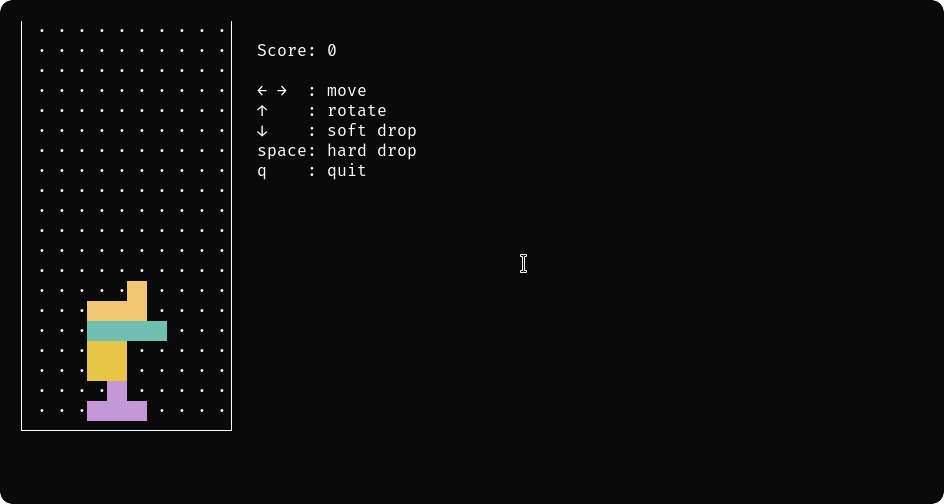

# tetris-cli

A falling-block puzzle game that runs in your terminal, written in Rust.



## Features

- Plays in any terminal, with colored pieces
- All 7 classic four-block shapes, with rotation and simple wall kicks
- Soft drop and hard drop
- Line clearing and scoring
- Game-over screen with an instant restart
- Small and fast: a single binary whose only dependency is [crossterm](https://crates.io/crates/crossterm)

## Controls

| Key           | Action                 |
| ------------- | ---------------------- |
| `←` / `→`     | Move left / right      |
| `↑`           | Rotate                 |
| `↓`           | Soft drop (move down)  |
| `Space`       | Hard drop              |
| `q` / `Esc`   | Quit                   |

On the game-over screen, press `r` or `Enter` to play again, or `q` / `Esc` to quit.

## Scoring

| Lines cleared at once | Points |
| --------------------- | ------ |
| 1                     | 100    |
| 2                     | 300    |
| 3                     | 500    |
| 4                     | 800    |

## Installation

### Arch Linux (AUR)

```bash
paru -S tetris-cli
# or
yay -S tetris-cli
```

### With Cargo

```bash
cargo install --git https://github.com/AbdillahHamzahAli/tetris-cli
```

### From source

```bash
git clone https://github.com/AbdillahHamzahAli/tetris-cli.git
cd tetris-cli
cargo run --release
```

The binary is written to `target/release/tetris-cli`.

### Build an Arch package yourself

```bash
cd packaging/aur
makepkg -si
```

## Requirements

- A terminal with Unicode and color support
- Rust 1.88 or newer (edition 2024), if you build from source

## Project structure

```
.
├── src/main.rs            # the whole game
├── packaging/aur/PKGBUILD # Arch Linux / AUR package
└── assets/preview.png     # screenshot used in this README
```

---

*This is an independent hobby project, not affiliated with or endorsed by The Tetris Company.*
